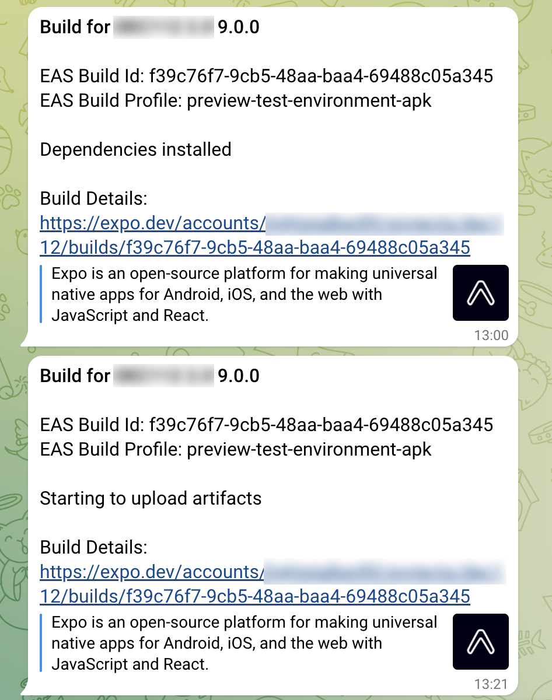

# EAS Build Notifier

Send Expo Build notifications to Telegram, Slack, Discord, or Microsoft Teams from your app's build lifecycle hooks.

## Install

Requires Node.js 22.12.0 or newer. Check the Node version on your Expo build image and set the build profile's [node field](https://docs.expo.dev/eas/json/) in `eas.json` if needed.

```sh
npm install --save-dev @meecode/eas-build-notifier
```

## Configure notifications

Create `eas-build-notifier.config.json` in your app directory. Keep the entries for the providers you use.

```json
{
  "services": [
    {
      "name": "telegram",
      "config": {
        "token": { "env": "TELEGRAM_BOT_TOKEN" },
        "chatID": { "env": "TELEGRAM_CHAT_ID" }
      }
    },
    {
      "name": "slack",
      "config": { "webhookUrl": { "env": "SLACK_WEBHOOK_URL" } }
    },
    {
      "name": "discord",
      "config": { "webhookUrl": { "env": "DISCORD_WEBHOOK_URL" } }
    },
    {
      "name": "teams",
      "config": { "webhookUrl": { "env": "TEAMS_WEBHOOK_URL" } }
    }
  ]
}
```

Set the referenced variables in the [Expo environment](https://docs.expo.dev/eas/environment-variables/manage/) used by your build profile. Use secret visibility for tokens and webhook URLs. For a local run, set the same variables in your shell. Literal config values are also supported for existing setups. Keep any file containing literal credentials out of version control.

- **Telegram** — Create a bot with BotFather. Send the bot a message, or send a command in the target group, then use the official [getUpdates API](https://core.telegram.org/bots/api#getupdates) to find the update's `message.chat.id`. Keep the bot token private.
- **Slack** — Create an [incoming webhook](https://api.slack.com/messaging/webhooks) for the destination channel.
- **Discord** — Create a [channel webhook](https://support.discord.com/hc/en-us/articles/228383668-Intro-to-Webhooks).
- **Microsoft Teams** — In Workflows, use a webhook template for your destination chat or channel. Configure the **When a Teams webhook request is received** trigger with **Anyone** authentication and copy the URL into `TEAMS_WEBHOOK_URL`. Treat the URL as a credential. The notifier sends an Adaptive Card using the [Teams Workflows webhook schema](https://learn.microsoft.com/en-us/connectors/teams/#when-a-teams-webhook-request-is-received).

## Add build hooks

Add these scripts to your app's `package.json` or adapt the [example](example/sample-package.json).

```json
{
  "scripts": {
    "eas-build-on-success": "eas-build-notifier notify --best-effort --file eas-build-notifier.config.json --message \"Build succeeded\"",
    "eas-build-on-error": "eas-build-notifier notify --best-effort --file eas-build-notifier.config.json --message \"Build failed\""
  }
}
```

For one hook that handles both outcomes, use `eas-build-on-complete`. The notifier includes `EAS_BUILD_STATUS` when Expo provides it. Expo also supports `eas-build-post-install` for progress notifications. The older `eas-build-pre-upload-artifacts` hook is deprecated. Invoke the notifier explicitly from your build steps when using a custom build. See the [Expo lifecycle hook reference](https://docs.expo.dev/build-reference/npm-hooks/).

Run a test notification from the app directory:

```sh
npx eas-build-notifier notify --file eas-build-notifier.config.json --message "Test notification"
```

By default, any delivery failure produces a nonzero exit code. With `--best-effort`, delivery failures are logged per provider and the command exits successfully. Invalid configuration still produces a nonzero exit code.



## Live integration tests

Copy `.env.test.example` to `.env.test` and fill in the credentials for the providers you want to test. Use a test chat or channel. Telegram needs both its bot token and chat ID.

```sh
npm run test:live
```

Each configured provider receives one test notification. Providers without test credentials are skipped. An HTTP success confirms the endpoint accepted the request. For Teams, also check that Workflows posted the card in the destination channel.

`.env.test` is ignored by Git. The live suite reads credentials only from that file. Regular `npm test` uses mocked requests and runs without credentials.

## License

[MIT](LICENSE.md)
